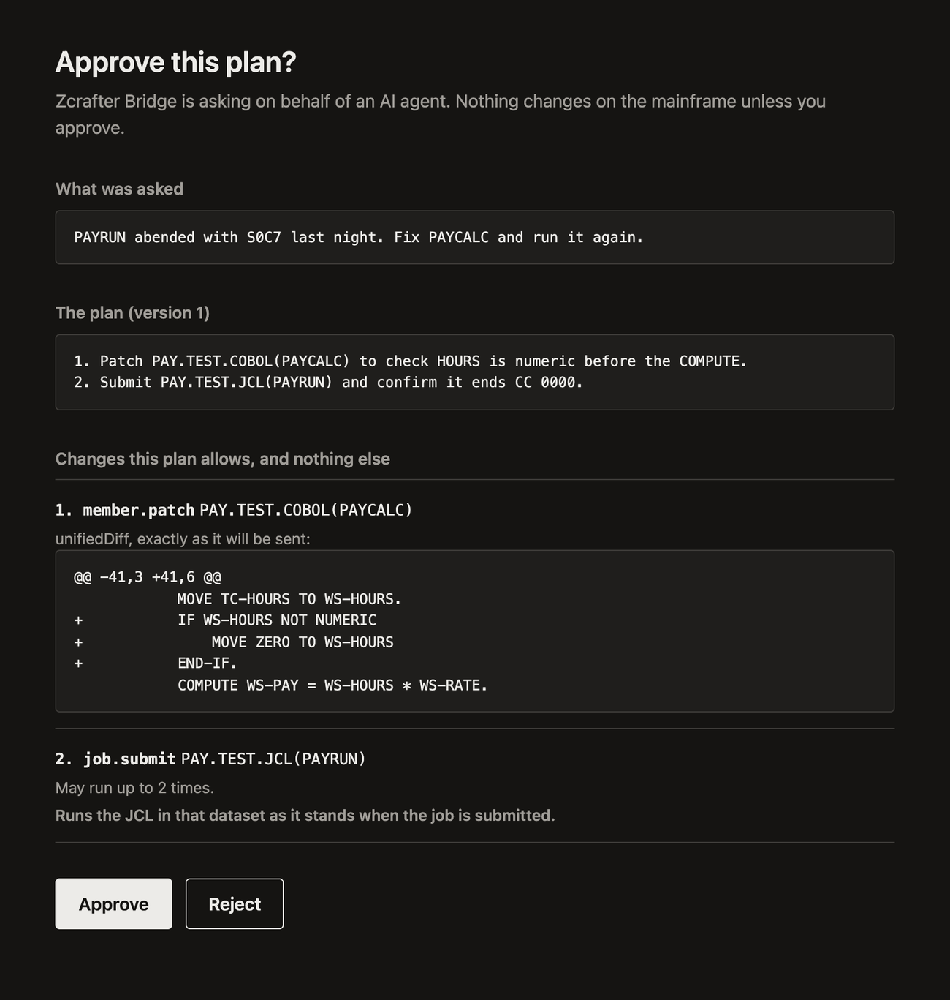

<p>
  <picture>
    <source media="(prefers-color-scheme: dark)" srcset="assets/zcrafter-logo-on-dark.png">
    
  </picture>
</p>

# Zcrafter Bridge

<!-- mcp-name: io.github.ZcrafterAI/bridge -->

Give AI Agents real access to your mainframe and keep it from changing anything you haven't approved.


## What's an MCP server?

MCP is how AI Agents talks to outside systems. An MCP server hands AI a set of tools it can call. Bridge is an MCP server whose tools are your mainframe - datasets, members, z/OS UNIX files, jobs, spool, TSO and the operator console, with an approval gate in front of anything that changes the system.

Install it once, point your AI client at it, then just talk.

---

## Try it in one minute, no mainframe needed

Bridge ships with a pretend mainframe. With [uv](https://docs.astral.sh/uv/) installed, add the demo to Claude Code:

```bash
claude mcp add bridge-demo -- uvx --from git+https://github.com/ZcrafterAI/Bridge zcrafter-bridge --demo
```

Then ask: *"PAYRUN abended last night. Find out why and fix it."* The agent finds the failed step, reads the program, and asks you to approve a plan before it changes anything. Nothing real is touched.

---

## Install

One line, on macOS and Linux:

```bash
curl -fsSL https://raw.githubusercontent.com/ZcrafterAI/Bridge/main/install.sh | sh
```

Or directly with uv, on any system including Windows:

```bash
uv tool install git+https://github.com/ZcrafterAI/Bridge
```

Either way you get one command, `zcrafter-bridge`. It needs Python 3.11 or newer, which uv fetches for you. It no longer needs Node.

### Connect your AI client

| Client | How |
|---|---|
| **Claude Code** | `claude mcp add zcrafter-bridge -- zcrafter-bridge` |
| **Codex** | In `~/.codex/config.toml`: `[mcp_servers.zcrafter-bridge]` then `command = "zcrafter-bridge"` |
| **Claude Desktop, Cursor, Gemini CLI** | Add the JSON below to the client's MCP settings |
| **VS Code** | The same entry under `"servers"` in `.vscode/mcp.json` |

```json
{
  "mcpServers": {
    "zcrafter-bridge": { "command": "zcrafter-bridge" }
  }
}
```

Claude Code users can also install the skill that teaches the agent the approval flow:

```bash
zcrafter-bridge install-skill
```

### Connect your mainframe

Bridge signs in to z/OSMF as you. It looks for your sign-in in this order:

1. **Environment variables**: `ZOWE_OPT_HOST`, `ZOWE_OPT_USER`, `ZOWE_OPT_PASSWORD` (and optionally `ZOWE_OPT_PORT`, `ZOWE_OPT_REJECT_UNAUTHORIZED`, `ZOWE_OPT_BASE_PATH`). These are Zowe CLI's own names.
2. **Your Zowe profile**: `~/.zowe/zowe.config.json`, with the password read from your operating system's keychain, where `zowe config secure` put it. Test the profile with `zowe zosmf check status`.

**No password is stored by Bridge**, and none is ever sent to the AI model.

---

## How the gate works

**Reading is free.** Listing datasets, reading members, checking jobs, searching spool — no approval needed.

**Changing anything is gated.** Before an agent can write a member, submit a job, run a command or delete a dataset, it must:

1. Open a request
2. Write a **spec** (what changes and why) and get your yes
3. Write a **plan** that lists every change as a step, and get your yes

**Only you can say yes.** The agent can ask for an approval. It cannot give one. Bridge asks you directly, outside the agent's reach:

- in your AI client's own prompt, when the client has one, or
- on a page Bridge opens in your browser, on your machine only, or
- in a terminal, with `zcrafter-bridge approve`, on a machine with no browser.

The page's address carries a one-time token the agent never sees, so an agent that can browse still cannot press Approve.



**Your yes covers the listed steps and nothing else.** Each step names one tool and its target, for example `member.write` on `PAY.TEST.COBOL(PAYCALC)`. After approval a change runs only if it matches a step, and each step runs once unless the plan says more. A command step fixes the exact command. A step can also fix the exact content, diff or JCL, and then that is what must be sent.

| The agent tries | It gets |
|---|---|
| A change before you approved | `PLAN_NOT_APPROVED` |
| To approve its own plan | `WAITING_FOR_PERSON`, and you get asked |
| A change the plan did not list | `STEP_NOT_IN_PLAN` |
| A change to a protected dataset | `PROTECTED_DATASET` |

Editing the spec after approval un-approves the plan too. Every change is logged with its inputs; passwords are redacted, diffs are hashed.

---

## Tools

48 tools. The ones in *italics* change the system, so they need an approved plan step.

| | |
|---|---|
| **Datasets** | list, info, read, *write, create, create like, delete, rename, copy, recall, migrate* |
| **Members** | list, read, search, *write, patch, delete, rename* |
| **z/OS UNIX files** | list, read, *write, create, delete, rename, chmod* |
| **Jobs** | list, status, steps, failed jobs, wait, JCL, spool, output, *submit, cancel, purge, hold, release, change class* |
| **TSO** | `tso.query` for read-only commands (LISTCAT, LISTDS, LISTUSER...), *`tso.command` for anything else* |
| **Operator console** | *`console.command`* |
| **System** | list systems, verify connection, list profiles, search the tool catalog |

`job.steps` shows which step of a job failed, and `job.failed` lists the jobs that ended badly, so an agent can start from the failure instead of reading every log.

Large reads (`member.read`, `dataset.read`, `job.output`, `job.spool.read`) accept `searchText`, `maxLines` and `regex` — so Claude finds one line in a 40,000-line job log instead of pulling the whole thing into context.

---

## Configuration

Copy `.env.example` to `.env` to change defaults.

| Variable | Default | |
|---|---|---|
| `MAINFRAME_WORKFLOW_ZOWE_PROFILE` | `default` | Which Zowe profile to use |
| `MAINFRAME_WORKFLOW_DB_PATH` | `~/.zcrafter-bridge/state.db` | Where requests are stored |
| `MAINFRAME_WORKFLOW_IDLE_DAYS` | `14` | Abandon untouched requests after |
| `MAINFRAME_WORKFLOW_RETENTION_DAYS` | `90` | Archive finished requests after |
| `MAINFRAME_WORKFLOW_APIML_BASE_PATH` | — | Set if z/OSMF is behind API ML |
| `MAINFRAME_WORKFLOW_APPROVAL` | `auto` | How you approve: `auto` (your AI client's prompt, else a browser page), `prompt`, `browser`, `terminal` |
| `MAINFRAME_WORKFLOW_APPROVAL_WAIT_SECONDS` | `60` | How long one approval call waits for you before telling the agent to ask again |
| `MAINFRAME_WORKFLOW_READ_ONLY` | `false` | `true` offers no tool that changes anything |
| `MAINFRAME_WORKFLOW_PROTECTED_DATASETS` | — | Patterns the dataset and member tools may never write to, e.g. `SYS1.**,*.PROD.**` |
| `MAINFRAME_WORKFLOW_TSO_ACCOUNT` | `ACCT` | TSO account number, used on z/OSMF without the one-request TSO interface |

`MAINFRAME_WORKFLOW_APPROVAL=unsafe-agent` turns the person off: the agent's own call counts as approval. It exists for automated runs against throwaway systems. Do not use it on a mainframe you care about.

---

## Troubleshooting

**`Zowe config not found`** — Bridge reads `~/.zowe/zowe.config.json`. Run `zowe config list` to confirm you have one, or set `ZOWE_OPT_HOST`, `ZOWE_OPT_USER` and `ZOWE_OPT_PASSWORD`.

**`z/OSMF profile "default" not found`** — your profile has another name. Run `zowe config list profiles`, then set `MAINFRAME_WORKFLOW_ZOWE_PROFILE` in `.env`.

**`...is missing host, user or password`** — credentials aren't in your OS keychain. Re-run `zowe config secure`.

**`could not read the OS keychain`** — the machine has no keychain Bridge can open (common on servers and in containers). Use the `ZOWE_OPT_*` variables there.

**Claude says a tool isn't allowed** — approve it when prompted, or check `claude mcp list`.

**The agent says an approval is waiting but nothing opened** — the address is printed in the server's log (stderr), or run `zcrafter-bridge approve` in a terminal.

**`STEP_NOT_IN_PLAN`** — the agent tried a change you did not approve. It has to write a new plan revision that lists it and ask you again.

**`tso.command` or `console.command` answers 401 or 403** — your user ID needs TSO or EMCS console authority on the mainframe. Bridge cannot grant it.

---
## Development

```bash
git clone https://github.com/ZcrafterAI/Bridge.git && cd Bridge
python -m venv .venv && source .venv/bin/activate    # Windows: .venv\Scripts\activate
pip install -e ".[dev]"
pytest                                               # 184 tests, no mainframe needed
python -m mainframe_workflow_mcp.cli --demo          # run from source
```

`credential-resolver/` is the older Node helper for reading the Zowe keychain. Bridge reads the keychain itself now and only falls back to the helper if you have built it (`cd credential-resolver && npm install && npm run build`).

Architecture notes: [docs/architecture.md](docs/architecture.md). The tool catalog lives in `mainframe_workflow_mcp/toolbox/` and the z/OSMF calls in `mainframe_workflow_mcp/clients/`.

---

MIT licensed. Contributions welcome — see [CONTRIBUTING.md](CONTRIBUTING.md).
